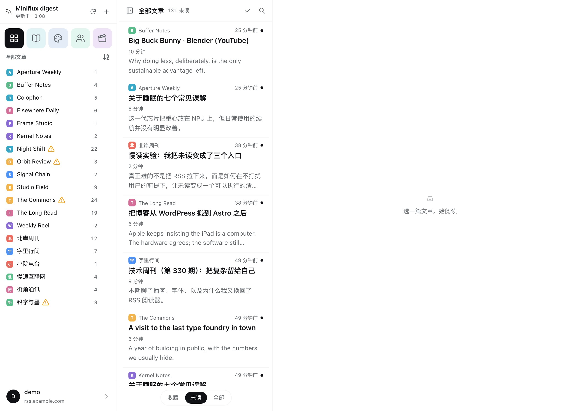
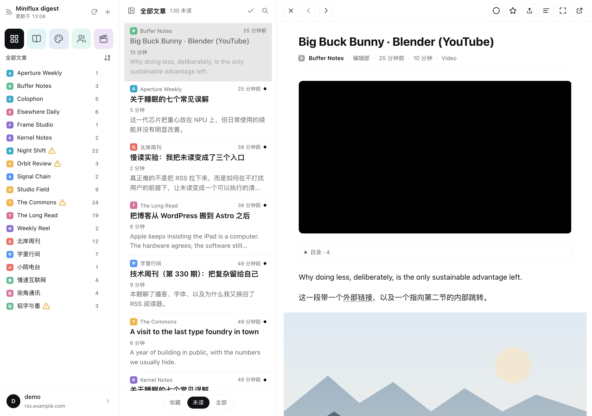
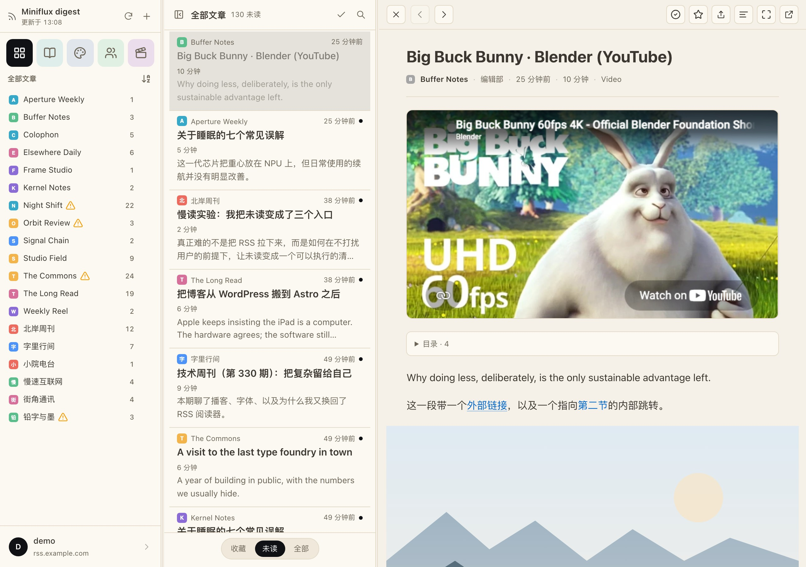
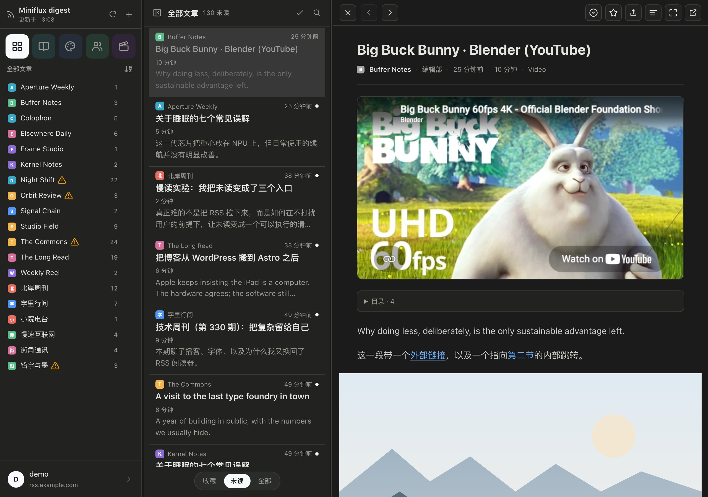
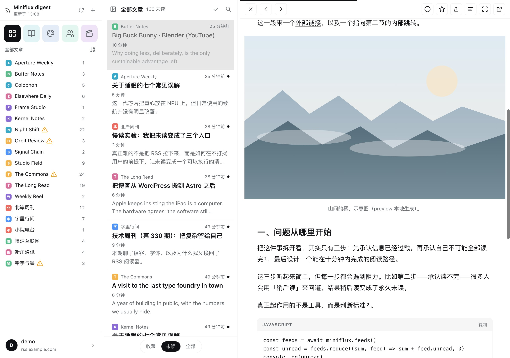
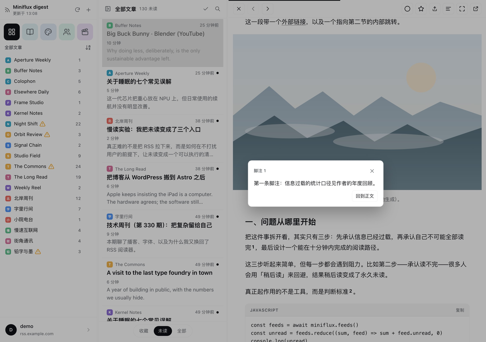
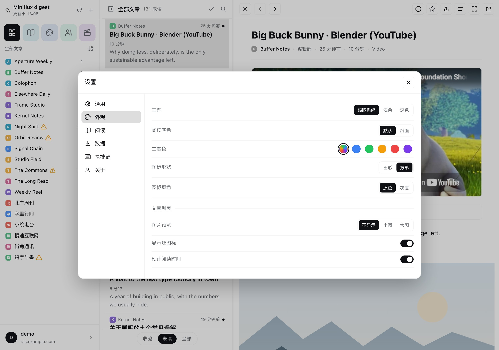

# Miniflux Digest

**A desktop reader and AI digest plugin for Miniflux inside DeepSeek Harness.**

[English](#features) | [中文说明](#中文说明)

Bring your Miniflux subscriptions directly into DeepSeek Harness. Miniflux Digest provides a dedicated, distraction-free three-column reading workspace—skim incoming feeds, immerse yourself in long-form articles, and let your AI assistant synthesize daily digests, extract insights, or recommend key readings without context switching.



## Screenshots

| Reading View | Paper Texture |
| --- | --- |
|  |  |

| Dark Mode | Media & Code |
| --- | --- |
|  |  |

| In-Place Footnotes | Settings & Appearance |
| --- | --- |
|  |  |

## Features

- **Three-column reading workspace:** Categories and feeds on the left, an article feed in the center, and the full reader on the right. Everything opens in place without spawning external tabs.
- **Crafted for long-form reading:** Configurable font sizes, line heights, and reading measures. Includes a soothing paper texture mode, a refined dark theme (with softened text brightness for eye comfort), breakout figures, syntax-highlighted code blocks, and footnotes that expand directly at the anchor point.
- **Instant state restoration:** Remembers your active feed, article, and exact scroll position. Thanks to local state caching, reopening the panel displays content instantly without layout shifts or cold-start blanks.
- **Instant after the first open:** Articles you have already read and categories you have already visited come straight from memory. Resting the pointer on a row, or simply reading on with `j` / `k`, puts the next article in flight before you click it. The first open still waits once for Miniflux; after that a click is effectively immediate.
- **Synchronized triage filters:** Switching between Starred, Unread, and All states simultaneously updates both feed badges and the article queue.
- **Embedded media playback:** Plays video embeds from YouTube, Bilibili, and X (Twitter) natively within the reader.
- **Keyboard-driven workflow:** Navigate articles and manage state effortlessly using standard reader keys (`j` / `k` to move, `m` to toggle read, `s` to star, `c` to copy clean Markdown, `v` to visit the original web page).
- **Deep assistant integration:** Built-in tools allow your AI agent to query unread statistics, summarize whole categories, or parse article content using the same account and read states.
- **Bilingual interface:** Seamlessly switch between English and Simplified Chinese under Settings → General.

## Requirements

- DeepSeek Harness >= 0.2
- Miniflux instance >= 2.0 (Miniflux >= 2.3.2 required for batch starring)

## Installation

```bash
dsh plugin --profile desktop add /path/to/dsh-miniflux-digest
```

After installing, enable `rss-miniflux` in your Plugin Manager. The reading panel will dock into the sidebar.

To update, pull the latest repository changes and toggle the plugin switch off and on again.

## Connecting to Miniflux

On initial launch, the setup modal will prompt you for your server address and API token (generate one in Miniflux under **Settings → API Keys**). The plugin tests the connection immediately.

You can also provide credentials via environment variables or plugin configuration:

```yaml
- id: rss-miniflux
  name: 'rss-miniflux-deepread'
  config:
    baseUrl: https://rss.example.com
    timeoutMs: 15000
```

Alternatively, export `MINIFLUX_BASE_URL` and `MINIFLUX_API_TOKEN` in your environment.
Precedence: Plugin Configuration > Saved Credentials > Environment Variables.

> **Tip:** You can explore the full interface without credentials by closing the setup dialog to load the built-in demo feeds.

## Assistant Tools

The plugin provides six tools that share session credentials and unread states with the desktop UI:

| Tool | Purpose |
| --- | --- |
| `miniflux_overview` | Checks connection status and summarizes unread counts across categories and feeds |
| `miniflux_digest` | Generates an unread digest covering time range, feed distribution, recurring themes, and recommended deep reads |
| `miniflux_briefing` | Produces an executive briefing for a specific category directly in the conversation |
| `miniflux_read` | Retrieves full article content formatted as clean Markdown |
| `miniflux_search` | Searches subscriptions by keyword |
| `miniflux_act` | Toggles read/unread status, updates stars, or triggers feed and category refreshes |

### Example Prompts

> "Give me a briefing on the Tech category and highlight the top 3 recurring topics."

> "Check my unread queue and recommend three articles worth a slow read, along with your reasons."

## Privacy & Security

- **Local credential isolation:** API tokens are stored securely in your local Harness profile vault—never exposed to disk configs or committed to version control.
- **Direct communication:** Network calls connect strictly to your configured Miniflux server. Embedded X post videos resolve streams via `cdn.syndication.twimg.com`.
- **Stateless caching:** Memory caches and UI snapshots exist only to deliver instantaneous page restoration. Disconnecting, logging out, or switching accounts flushes all cached data.
- **Restrained prefetching:** A prefetch fires only after the pointer rests 140 ms on a row, never more than two at a time, never for something already cached, and idle warming runs in its own lane so it can never delay a click. X media is a second request, after the article body is already on screen.

## Limitations

- Requires an active, reachable Miniflux server; offline reading sync is not supported.
- Optimized for desktop-width displays; very narrow split panels may compress the reading column.
- Advanced capabilities like original content extraction, automatic feed discovery, and batch starring depend on your server-side Miniflux version.
- The Starred view indexes the most recent 1,000 starred entries; extremely large archives will display recent subsets.
- Built-in demo mode uses synthetic mock data for initial UI previews.

For comprehensive implementation notes—including HTML sanitization, code detection, and video player fallbacks—refer to [docs/limitations.md](docs/limitations.md).

## Documentation

| Document | Contents |
| --- | --- |
| [docs/ui-reference.md](docs/ui-reference.md) | Component-by-component overview of the reader interface |
| [docs/design.md](docs/design.md) | Architectural rationale and comparison against Nextflux |
| [docs/limitations.md](docs/limitations.md) | Edge cases, formatting rules, and version matrix |
| [docs/troubleshooting.md](docs/troubleshooting.md) | Credential management, recovery steps, and debugging logs |
| [docs/verification.md](docs/verification.md) | Test coverage and verification status |
| [docs/development.md](docs/development.md) | Local preview workflow, screenshot generation, and project layout |
| [docs/loading-performance.md](docs/loading-performance.md) | First-frame snapshot caching, warm-path caches and prefetching |
| [docs/ringo-reading-design.md](docs/ringo-reading-design.md) | Typography and reading surface design choices |

## License

MIT, see [LICENSE](LICENSE).

All feed names, article headlines, and sample articles in `preview/data.mjs` and `lib/demo.js` are fictional. Preview screenshots in `preview/shots/` are generated from these sample fixtures. Do not commit actual account credentials, server addresses, or personal subscription lists into this repository.

---

# 中文说明

**面向 DeepSeek Harness 的 Miniflux RSS 阅读与智能体简报插件。**

[English](#features) | [功能特性](#功能特性)

将你的 Miniflux 订阅无缝接入 DeepSeek Harness 桌面侧栏。Miniflux Digest 提供了专为桌面阅读打造的三栏工作区——无需在浏览器标签页与阅读器之间来回切换，即可在专注的排版中梳理未读流、沉浸阅读长文，并随时让 AI 助手梳理每日资讯、提炼专题简报或推荐精读内容。

## 功能特性

- **经典三栏布局**：左侧分类与订阅源树、中间文章信息流、右侧正文阅读区，所有操作原地完成，告别外跳标签页的碎片体验。
- **专注长文阅读质感**：自由调节字号、行高与行宽；预置明亮、暗色以及温润的舒缓纸面（Paper）三种配色（暗色模式下正文亮度轻微柔化，减轻眼部疲劳）；支持宽幅图片自适应展示、原地直接展开的交互脚注，以及带语言标签的代码语法高亮。
- **阅读状态秒级恢复**：自动记忆上次聚焦的分类、阅读文章与精确滚动位置。基于轻量本地快照机制，再次打开面板立即可见内容，无白屏加载与布局跳动。
- **第二次打开起基本不用等**：读过的文章、逛过的分类直接来自内存；鼠标在列表行上停一下、或用 `j` / `k` 读下去时，下一篇已经在路上。第一次打开仍需等一次 Miniflux。
- **分类与列表实时联动**：星标、未读、全部等筛选维度在左侧源列表与中间文章列表间保持双向同步。
- **多媒体原生内嵌**：文章中引用的 YouTube、Bilibili 及 X（Twitter）视频直接在阅读区原地嵌入播放，无需跳转第三方网站。
- **全键盘快捷键流**：遵循经典阅读器习惯，支持 `j` / `k` 上下移动、`m` 标记已读、`s` 收藏星标、`c` 一键复制整洁 Markdown、`v` 访问原文。
- **智能体深度联动**：内置 6 项原子助手工具，与侧栏共用同一账号会话与已读状态，让模型随时为你生成未读速览、专题汇总或抓取全文。
- **双语界面支持**：原生适配简体中文与英文，可随时在「设置 → 通用」中自由切换。

## 系统要求

- DeepSeek Harness >= 0.2
- Miniflux 实例 >= 2.0（批量星标功能需 2.3.2 及以上）

## 安装方式

```bash
dsh plugin --profile desktop add /path/to/dsh-miniflux-digest
```

安装完成后，在 Harness 插件管理器中开启 `rss-miniflux`，阅读面板即停靠在侧边栏中。

如需更新，直接拉取仓库最新代码，并在插件管理中重新开关一次插件即可生效。

## 连接与配置

初次打开面板时，在弹出的配置对话框中填入你的 Miniflux 服务器地址与 API 令牌（在 Miniflux 中打开 **设置 → API 密钥** 生成），插件将立即校验连通性。

如需免交互配置，可通过插件配置或环境变量预设凭据：

```yaml
- id: rss-miniflux
  name: 'rss-miniflux-deepread'
  config:
    baseUrl: https://rss.example.com
    timeoutMs: 15000
```

或在系统环境变量中导出 `MINIFLUX_BASE_URL` 与 `MINIFLUX_API_TOKEN`。
生效优先级：插件配置 > 已保存凭据 > 环境变量。

> **提示**：若暂无可用服务器，可直接关闭初始配置弹窗，直接体验内置的虚构演示条目。

## 助手工具

插件内置 6 项工具，与前端面板共享同一 Miniflux 凭据和未读数据状态：

| 工具 | 功能说明 |
| --- | --- |
| `miniflux_overview` | 查询当前连接状态，并按分类与订阅源汇总未读文章统计 |
| `miniflux_digest` | 梳理未读条目，生成包含时间范围、来源分布、核心议题与深度阅读建议的速览 |
| `miniflux_briefing` | 针对指定分类在对话中直接生成模型撰写的结构化简报 |
| `miniflux_read` | 提取指定文章完整正文，输出为格式规范的 Markdown |
| `miniflux_search` | 按关键词全局检索已订阅条目 |
| `miniflux_act` | 执行操作：标记已读/未读、添加/取消星标、触发单源或分类刷新 |

### 常用提问示例

> 帮我按「科技」分类生成一份简报，梳理出出现频次最高的三个核心话题。

> 快速看一眼我当前的未读列表，挑出三篇最值得慢读的文章并说明推荐理由。

## 数据安全与隐私

- **凭据本地隔离**：API 令牌仅加密保存在本机 Harness 凭据管理器中，绝不会写入仓库代码或明文配置中。
- **纯净直接通信**：所有网络请求仅直连你指定的 Miniflux 实例（内嵌 X 视频流仅通过官方 `cdn.syndication.twimg.com` 解析）。
- **即用即清缓存**：内存缓存与快照仅用于提升再次打开的响应速度；登出、断开连接或切换账号时会自动清空全部缓存。
- **预取有节制**：悬停停留 140 ms 才发请求，同一时刻最多两个，已缓存的跳过；空闲预热走单独一条车道，不会让点击排在预取后面。X 推文是正文出来之后的第二次请求。

## 使用限制

- 需连接可访问的 Miniflux 实例，暂不支持完全脱机离线同步。
- 专为桌面端窗口宽度优化，分屏或过窄窗口下阅读栏可能会受到挤压。
- 原文抓取、源探测与批量星标等高级特性受服务端 Miniflux 版本影响。
- 星标视图默认索引最近 1,000 条收藏条目，超大规模归档将仅呈现最新批次。
- 演示模式数据均为虚拟生成，仅用于无服务器环境下的界面预览。

有关段落缩进规则、代码块识别逻辑与视频边界处理等详细技术说明，请参阅 [docs/limitations.md](docs/limitations.md)。

## 文档索引

| 文档 | 主要内容 |
| --- | --- |
| [docs/ui-reference.md](docs/ui-reference.md) | 面板界面分区与全部交互控件详解 |
| [docs/design.md](docs/design.md) | 架构设计考量及与 Nextflux 的能力对照 |
| [docs/limitations.md](docs/limitations.md) | 边界场景、排版规则与版本兼容性说明 |
| [docs/troubleshooting.md](docs/troubleshooting.md) | 凭据管理、故障排查与调试日志指南 |
| [docs/verification.md](docs/verification.md) | 功能验证范围与测试状态记录 |
| [docs/development.md](docs/development.md) | 本地预览开发、截图生成与代码目录映射 |
| [docs/loading-performance.md](docs/loading-performance.md) | 首帧快照缓存与即时渲染优化机制 |
| [docs/ringo-reading-design.md](docs/ringo-reading-design.md) | 阅读界面与排版体系设计决策 |

## 开源许可

本项目基于 MIT 许可证分发，详见 [LICENSE](LICENSE)。

`preview/data.mjs` 与 `lib/demo.js` 中包含的订阅源名称、文章标题和正文均为虚拟构造，`preview/shots/` 目录中的预览截图亦基于虚构数据渲染生成。请勿将真实的账号凭据、私有服务器地址或个人订阅列表提交至本仓库。
